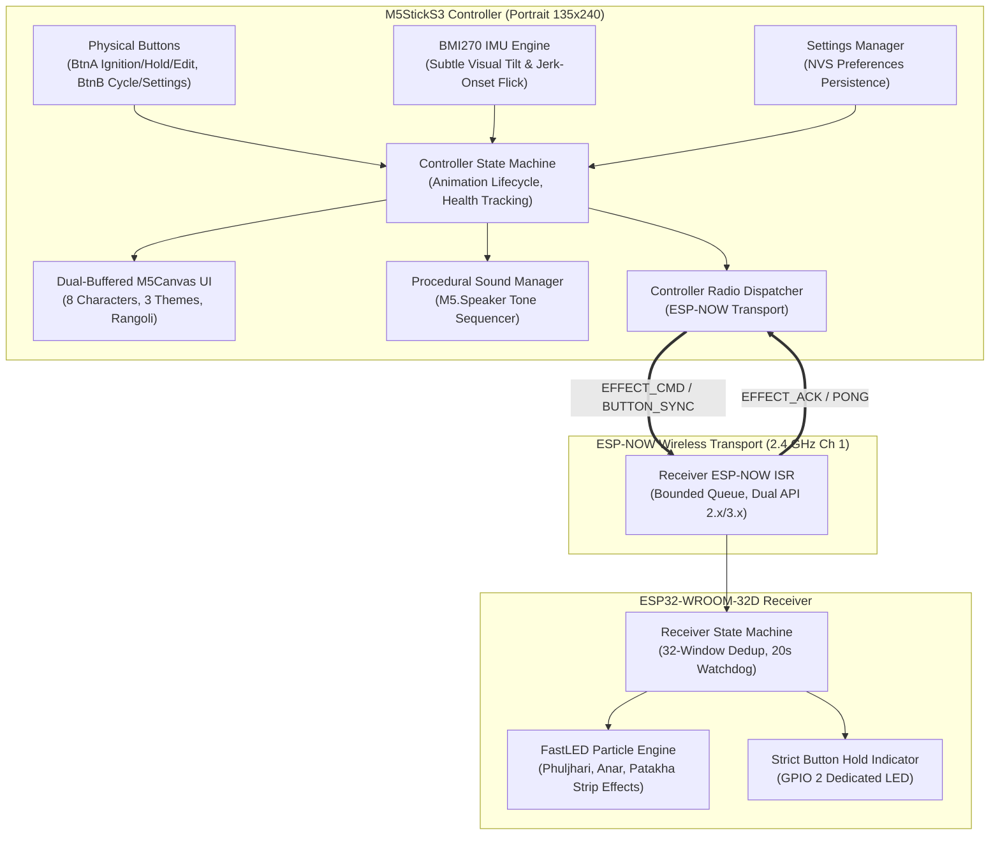

# Project Phuljhari 2.0 ✨ (Pocket Diwali Festival)

[](https://github.com/Vivek-live-now/Phuljhari/actions/workflows/ci.yml)
[](file:///data/data/com.termux/files/home/phuljhari/shared/phuljhari_protocol.h)
[](file:///data/data/com.termux/files/home/phuljhari/shared/phuljhari_safety.h)
[](file:///data/data/com.termux/files/home/phuljhari/platformio.ini)

> **Tagline:** *Tiny sparks. Wireless smiles.*  
> An interactive, portrait-oriented Diwali simulator and wireless decorative light controller for **M5StickS3** paired with an **ESP32-WROOM-32D** receiver over low-latency **ESP-NOW**.

---

## 🌟 Table of Contents
1. [What's New in Phuljhari 2.0](#-whats-new-in-phuljhari-20)
2. [Safety Boundary & Compliance](#-safety-boundary--compliance)
3. [The 8 Festive Characters](#-the-8-festive-characters)
4. [Controls & Gesture Interactions](#-controls--gesture-interactions)
5. [Procedural Audio Engine](#-procedural-audio-engine)
6. [Interactive Settings & Persistence](#-interactive-settings--persistence)
7. [System Architecture](#-system-architecture)
8. [Wiring & Power Guide](#-wiring--power-guide)
9. [ESP-NOW Protocol Specification](#-esp-now-protocol-specification)
10. [Build & Verification Instructions](#-build--verification-instructions)
11. [Troubleshooting Guide](#-troubleshooting-guide)
12. [Physical Bench-Test Checklist](#-physical-bench-test-checklist)

---

## 🎆 What's New in Phuljhari 2.0

**Phuljhari 2.0** transforms the handheld M5StickS3 into a pocket-sized Diwali celebration:
* **Portrait Ergonomics (135 × 240):** Natural vertical handheld layout with thumb Button A comfortably positioned at the bottom and index Button B on the side.
* **Expanded Roster of 8 Festive Characters:** From classic golden sparklers and fountain cones to spinning chakris, sky rockets, sparkler garlands, cute cartoon bomb mascots, candles, and traditional glowing diyas.
* **Deliberate Flick-to-Start:** A dedicated jerk-onset G-force detector triggers celebratory cracker animations with a crisp flick of the wrist.
* **Procedural Personality Sound Effects:** Integrated multi-step tone sequencer using `M5.Speaker` synthesizing pops, crackles, ascending whooshes, chimes, and tactile UI feedback.
* **Dedicated Settings Screen & NVS State Persistence:** Configurable wireless toggle, sound volume, tilt/flick toggles, sensitivity presets, power-saving frame rates, background night themes, and glowing rangoli floor art.
* **Strict Safety & GPIO 2 Exclusivity:** Preserves strict hardware isolation where receiver GPIO 2 is exclusively driven by physical button presses and hold-sync messages with failsafe auto-cutoff.

---

## 🛡️ Safety Boundary & Compliance

> [!IMPORTANT]  
> **Exclusively for Low-Voltage Decorative LED Lighting & Harmless Screen Simulation.**  
> Project Phuljhari is designed solely for driving addressable RGB LEDs (WS2812B, SK6812) and low-voltage bench indicator LEDs (≤ 5V DC).  
> **Under no circumstances should this system be modified or connected to pyrotechnic igniters, electric matches (e-matches), model rocket motors, heating coils, or high-energy actuators.**

### Built-in Failsafe Architecture
1. **Default Inactive (LOW) Startup:** All GPIO output pins are explicitly initialized to `LOW` on bootloader startup.
2. **Watchdog Communication Auto-Cutoff:** If the receiver does not receive valid commands or keepalive heartbeats within **20 seconds** (`PHULJHARI_WATCHDOG_TIMEOUT_MS`), all LED outputs are automatically extinguished and the receiver reverts to `SAFE_IDLE`.
3. **Hard Clamped Duration Limits:** Any incoming effect duration exceeding **15 seconds** is clamped to safe limits (`PHULJHARI_MAX_DURATION_MS`), with an absolute default of **5 seconds**.
4. **Brightness & Thermal Protection:** Firmware enforces an intensity ceiling of `180 / 255` (~70% maximum) in [`receiver_config.h`](file:///data/data/com.termux/files/home/phuljhari/receiver/include/receiver_config.h) to eliminate USB port overcurrent brownouts and excessive thermal dissipation.
5. **Strict Button-Controlled GPIO 2:** Receiver GPIO 2 responds exclusively to valid `BUTTON_DOWN`, `BUTTON_SYNC`, and `BUTTON_UP` packets. Zero coupling to heartbeat pings, effect commands, or idle animations.
6. **Lost Button-Hold Cutoff:** A 600 ms receiver timeout automatically deactivates the live hold indicator if wireless communication drops while the button is physically held.

---

## 🎭 The 8 Festive Characters

Each character features large portrait artwork, personality facial expressions, idle breathing animations, celebratory playing fireworks, and procedural sound effects:

| Character | Name | Theme | Wireless Effect | Audio Personality |
| :---: | :--- | :--- | :---: | :--- |
| **0** | **✨ Phuljhari** | Golden Sparkler | `EFFECT_ID_PHULJHARI` | Sparkling golden shimmer & bright sparkles |
| **1** | **🎆 Anar** | Festive Fountain | `EFFECT_ID_ANAR` | Ascending fountain crescendo with gravity splash |
| **2** | **🚀 Sky Rocket** | Sky Rocket | `EFFECT_ID_PATAKHA` | Rising whoosh followed by aerial bloom pop |
| **3** | **🎋 Garland** | Sparkler Garland | `EFFECT_ID_PATAKHA` | Rapid rhythmic cheerful pops & twinkling sparks |
| **4** | **💣 Patakha Bomb** | Cute Mascot Bomb | `EFFECT_ID_PATAKHA` | Mascot drop whistle followed by friendly comic pop |
| **5** | **🌀 Chakri** | Ground Wheel | `EFFECT_ID_ANAR` | Whirling airy hum with expanding circular sparks |
| **6** | **🕯️ Candle** | Luminous Candle | `EFFECT_ID_PHULJHARI` | Peaceful warm harmonic chimes with gentle flame flutter |
| **7** | **🪔 Diya** | Traditional Oil Lamp | `EFFECT_ID_PHULJHARI` | Serene festive chimes with warm golden glow |

---

## 🎮 Controls & Gesture Interactions

### Device Orientation & Ergonomics
The M5StickS3 display runs in **Portrait Mode (135 × 240, rotation 0)**:
```
           +-------------------------+
           | [● LINK] [SFX] [BAT 95%]|  <-- Top Telemetry Bar
           |                         |
           |         \  |  /         |
           |       -- (^_^) --       |  <-- Large Animated Cracker
           |         /  |  \         |
           |        [ Phuljhari ]    |
           |                         |
           |    ░░░░░░░░░░░░░░░░░    |  <-- Glowing Rangoli Layer
           +-------------------------+
             [ Btn A: Tap/Hold/Edit ]   [ Btn B: Cycle / Settings ]
```

### 1. Deliberate Flick-to-Start Gesture
* **Deliberate Flick Detection:** A sudden wrist flick exceeding threshold (MED: `1.35 G`, LOW: `1.65 G`, HIGH: `1.10 G`) with a dynamic onset jerk (`Δa ≥ 0.25 G`) ignites the selected cracker into its celebratory playing animation.
* **Cooldown Protection:** A 700 ms cooldown prevents accidental double-triggers from single hand motions.
* **Tilt Separation:** Static tilt generates approximately `1.0 G` total gravity with `Δa ≈ 0`, strictly preventing false flick triggers during tilting.

### 2. Physical Button Controls
* **Front Thumb Button (Btn A):**
  * **Short Tap (< 300 ms):** Alternative ignition control. Starts the cracker celebration and sends an ESP-NOW command if wireless is enabled.
  * **Press and Hold:** Engages live button synchronization. Transmits `BUTTON_DOWN`, periodic 180 ms `BUTTON_SYNC`, and `BUTTON_UP`, holding receiver GPIO 2 ON while pressed.
  * **In Settings Mode:** Toggles or cycles the currently selected setting row.
* **Side Button (Btn B):**
  * **Short Click:** Exclusively cycles forward through all 8 festive characters (`Phuljhari` &rarr; `Anar` &rarr; `Sky Rocket` &rarr; `Garland` &rarr; `Patakha Bomb` &rarr; `Chakri` &rarr; `Candle` &rarr; `Diya`).
  * **Long Press (> 600 ms):** Enters or exits the Settings Screen without resetting festival state.

### 3. Subtle Visual Tilt (BMI270 IMU)
* Tilting the controller gently left or right tilts the character sprite and curves particle trajectories in real time (clamped to ±0.30 radians).
* Returning the device upright smoothly returns the character to vertical neutral (0 rad).
* **Strict Boundary:** Tilt alters visual rotation only; it **never** cycles characters or sends radio commands.

---

## 🔊 Procedural Audio Engine

Phuljhari 2.0 features an embedded non-blocking procedural tone sequencer running on `M5.Speaker`:
* **Zero External Audio Files:** Synthesizes cheerful tones procedurally with frequency sequences and microsecond pacing.
* **Configurable Volume:** Scaled from 0% to 100% in 25% increments via Settings.
* **Silent Mode:** At volume 0% or when sound is toggled OFF, `M5.Speaker.stop()` ensures complete hardware silence.
* **Tactile Feedback:** Crisp 1400 Hz 30 ms chirp on button clicks and setting toggles.

---

## ⚙️ Interactive Settings & Persistence

Hold **Button B (> 600 ms)** to open the 10-row portrait Settings Screen. Use **Button B** (click) to navigate rows and **Button A** (tap) to toggle values:

| Row | Option | Range / States | Description |
| :---: | :--- | :--- | :--- |
| **0** | **Wireless** | `ON` / `OFF` | Enables or suspends ESP-NOW radio dispatch. Offline mode allows full standalone visual simulation. |
| **1** | **Sound** | `ON` / `OFF` | Toggles speaker audio output. |
| **2** | **Volume** | `0%` to `100%` (25% steps) | Sets master audio volume. |
| **3** | **Tilt** | `ON` / `OFF` | Enables/disables IMU visual tilt responsiveness. |
| **4** | **Flick** | `ON` / `OFF` | Enables/disables flick-to-start gesture trigger. |
| **5** | **Flick Sens** | `LOW` (1.65G) / `MED` (1.35G) / `HIGH` (1.10G) | Configures jerk threshold sensitivity. |
| **6** | **Power Save** | `ON` (18 FPS) / `OFF` (35 FPS) | Switches display refresh rate to conserve battery. |
| **7** | **Theme** | `Rooftop` / `Courtyard` / `Bazaar` | Selects ambient background night sky and festive lanterns. |
| **8** | **Rangoli** | `ON` / `OFF` | Toggles glowing decorative rangoli floor art. |
| **9** | **[ BACK ]** | Return | Exits settings screen back to festival. |

*All settings are automatically saved to ESP32 Non-Volatile Storage (NVS via `Preferences`) and persist across power cycles.*

---

## 📐 System Architecture



---

## 🔌 Wiring & Power Guide

Detailed wiring specifications and electrical schematics are documented in [`WIRING_RECEIVER.md`](file:///data/data/com.termux/files/home/phuljhari/WIRING_RECEIVER.md).

```
+-------------------------------------------------------------------+
|                        ESP32-WROOM-32D                            |
|                                                                   |
|      [ VIN / 5V ] --------------------------> Strip +5V (Red)     |
|                                                                   |
|      [ GND ]      --------------------------> Strip GND (White)   |
|                                                                   |
|      [ GPIO 18 ]  ----[ 330Ω Resistor ]-----> Strip DIN (Green)   |
|                                                                   |
|      [ GPIO 2 ]   ==== Internal Trace ======> Onboard Blue LED    |
+-------------------------------------------------------------------+
       |          |
    [ +5V ]    [ GND ]
       |          |
       +---[ 1000 µF 6.3V Capacitor ]---+
```

---

## 📡 ESP-NOW Protocol Specification

The protocol uses explicit, big-endian packed binary frames with CRC8 error detection:

| Message Type | Hex Code | Direction | Purpose |
| :--- | :---: | :---: | :--- |
| `MSG_TYPE_PING` | `0x01` | Controller &rarr; Receiver | Periodic heartbeat keepalive (2000 ms) |
| `MSG_TYPE_PONG` | `0x02` | Receiver &rarr; Controller | Heartbeat response confirming link vitality |
| `MSG_TYPE_EFFECT_CMD` | `0x03` | Controller &rarr; Receiver | Effect activation (`effect_id`, `duration_ms`, `intensity`) |
| `MSG_TYPE_EFFECT_ACK` | `0x04` | Receiver &rarr; Controller | Application acknowledgement confirming command receipt |
| `MSG_TYPE_EFFECT_STOP` | `0x05` | Controller &rarr; Receiver | Immediate effect termination and LED blackout |
| `MSG_TYPE_BUTTON_DOWN` | `0x08` | Controller &rarr; Receiver | Initial press-and-hold trigger for receiver GPIO 2 LED |
| `MSG_TYPE_BUTTON_UP` | `0x09` | Controller &rarr; Receiver | Release event switching GPIO 2 OFF immediately |
| `MSG_TYPE_BUTTON_SYNC` | `0x0A` | Controller &rarr; Receiver | 180 ms periodic keepalive refreshing active hold |

---

## 🛠️ Build & Verification Instructions

### 1. Host Native Test Suite (Host Clang/GCC)
The complete protocol, safety logic, receiver state machine, controller logic, sound sequencer, flick detector, and acceptance suites compile natively without embedded hardware:

```bash
# Clone the repository
git clone https://github.com/Vivek-live-now/Phuljhari.git
cd Phuljhari

# Execute all 4 native test suites
./test/run_tests.sh
```

**Test Suites Executed:**
1. [`test/test_protocol.cpp`](file:///data/data/com.termux/files/home/phuljhari/test/test_protocol.cpp): CRC8 verification, big-endian byte roundtrips, truncated frames, sequence wraparound, safety duration & intensity clamping.
2. [`test/test_receiver_sm.cpp`](file:///data/data/com.termux/files/home/phuljhari/test/test_receiver_sm.cpp): Non-blocking lifecycle, 32-packet duplicate filtering, 20s watchdog cutoff, strict GPIO 2 exclusivity.
3. [`test/test_controller_sm.cpp`](file:///data/data/com.termux/files/home/phuljhari/test/test_controller_sm.cpp): 8-character cycling, animation lifecycle, flick jerk detection, sound sequencer, settings navigation, wireless toggle, and live button sync.
4. [`test/test_acceptance.cpp`](file:///data/data/com.termux/files/home/phuljhari/test/test_acceptance.cpp): Version mismatch rejection, receiver reboot recovery, watchdog cutoff, stale sync rejection, rapid press debounce, 600 ms lost release recovery, independent LED paths, and IMU decoupling.

---

### 2. Embedded Firmware Compilation (PlatformIO)

The repository provides a modular [`platformio.ini`](file:///data/data/com.termux/files/home/phuljhari/platformio.ini) configured for both targets:

```bash
# Build Receiver Firmware (ESP32-WROOM-32D)
pio run -e receiver_esp32dev

# Build Controller Firmware (M5StickS3)
pio run -e controller_m5sticks3

# Upload to Receiver (connect receiver via USB)
pio run -e receiver_esp32dev -t upload

# Upload to Controller (connect M5StickS3 via USB)
pio run -e controller_m5sticks3 -t upload
```

---

## 🔍 Troubleshooting Guide

| Issue | Probable Cause | Corrective Action |
| :--- | :--- | :--- |
| **Link indicator shows RED / OFFLINE** | Wireless disabled in settings or channel mismatch | Open Settings (hold Btn B >600ms) and ensure Wireless is ON. Confirm both devices are configured to Channel 1 in [`controller_config.h`](file:///data/data/com.termux/files/home/phuljhari/controller/include/controller_config.h). |
| **Flick gesture does not trigger cracker** | Flick disabled or sensitivity too low | Open Settings and verify Flick is ON. Set Flick Sensitivity to HIGH for gentle gestures. |
| **No sound playing** | Volume is 0% or Sound disabled | Check telemetry bar for speaker icon. Open Settings, set Sound to ON, and increase Volume (25%–100%). |
| **LED strip shows flickering or wrong colors** | Missing common ground or floating data line | Connect ESP32 `GND` directly to the LED strip `GND`. Add a `330Ω` inline resistor on `GPIO 18`. |
| **ESP32 Receiver fails to boot** | GPIO 2 pulled HIGH externally at boot | GPIO 2 is the `MTDO` strapping pin. Remove any external pull-ups on GPIO 2. |

---

## 📋 Physical Bench-Test Checklist

Before deploying the hardware into a decorative enclosure, perform this physical bench-test checklist:

- [ ] **Step 1: Visual Inspection & Wiring Safety**
  - [ ] Verify 330Ω resistor is installed on GPIO 18 data line.
  - [ ] Verify 1000 µF capacitor is connected across 5V and GND near strip input.
  - [ ] Confirm no external pull-ups exist on GPIO 2.
- [ ] **Step 2: Receiver Zero-Hardware Bench Test**
  - [ ] Flash `receiver_esp32dev` without strip attached.
  - [ ] Observe onboard LED: stays strictly OFF at boot and during idle (no automatic blinking or heartbeat).
- [ ] **Step 3: Controller Standalone Verification**
  - [ ] Flash `controller_m5sticks3`.
  - [ ] Verify portrait startup splash animation loads cleanly (135 × 240).
  - [ ] Test Btn B character cycling: verifies all 8 characters cycle smoothly with distinct artwork and idle poses.
  - [ ] Test flick gesture: perform a deliberate wrist flick; observe cracker igniting into its celebratory playing animation and personality sound playing.
  - [ ] Test IMU subtle visual tilt: tilt left/right slightly and observe cracker tilting smoothly (±0.30 rad) without cycling characters or transmitting effect commands.
  - [ ] Test Settings navigation: hold Btn B >600ms to open Settings; toggle Wireless, Sound, Volume, and Themes; verify state persists across reboots.
- [ ] **Step 4: End-to-End Wireless Pair Verification**
  - [ ] Power both devices within range.
  - [ ] Observe controller link indicator: transitions from `OFFLINE`/`RECON` to green `REC: OK`.
  - [ ] Tap **Btn A** or perform flick: confirm controller displays `ACK OK` toast and receiver onboard LED remains OFF (only strip effect runs).
  - [ ] Press and hold **Btn A**: confirm receiver onboard LED (GPIO 2) stays solidly ON for duration of hold and turns OFF immediately upon release.
  - [ ] Hold Btn A and power off controller: verify receiver onboard LED auto-cuts off within 600 ms.
- [ ] **Step 5: Full LED Strip Test (With External Power)**
  - [ ] Connect WS2812B strip to 5V external power supply with common ground to ESP32.
  - [ ] Trigger Phuljhari, Anar, and Patakha effects; observe color correctness and smooth fading.
  - [ ] Test emergency cutoff: power off controller or trigger timeout; verify strip extinguishes cleanly.

---

## 📄 License & Attribution

Project Phuljhari ✨ is licensed under the [MIT License](LICENSE).  
*Tiny sparks. Wireless smiles.* Designed with ❤️ for festive celebrations.
