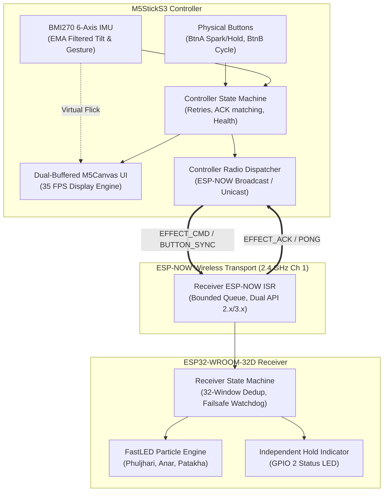
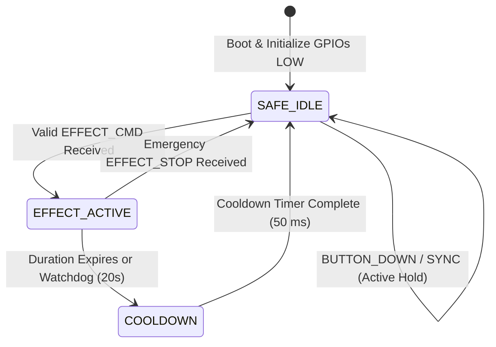

# Project Phuljhari ✨

[](https://github.com/Vivek-live-now/Phuljhari/actions/workflows/ci.yml)
[](file:///data/data/com.termux/files/home/phuljhari/shared/phuljhari_protocol.h)
[](file:///data/data/com.termux/files/home/phuljhari/shared/phuljhari_safety.h)
[](file:///data/data/com.termux/files/home/phuljhari/platformio.ini)

> **Tagline:** *Tiny sparks. Wireless smiles.*  
> A cute, polished, handheld wireless decorative light-control system pairing an **M5StickS3** controller with an **ESP32-WROOM-32D** receiver over low-latency **ESP-NOW**.

---

## 🌟 Table of Contents
1. [Project Overview](#-project-overview)
2. [Safety Boundary & Compliance](#-safety-boundary--compliance)
3. [System Architecture](#-system-architecture)
4. [Hardware Specifications](#-hardware-specifications)
5. [Wiring & Power Guide](#-wiring--power-guide)
6. [ESP-NOW Protocol Specification](#-esp-now-protocol-specification)
7. [User Controls & Characters](#-user-controls--characters)
8. [Build & Verification Instructions](#-build--verification-instructions)
9. [Troubleshooting Guide](#-troubleshooting-guide)
10. [Physical Bench-Test Checklist](#-physical-bench-test-checklist)

---

## 🎆 Project Overview

**Project Phuljhari** brings the festive delight of sparkling decorative lights into a safe, wireless, handheld experience. 

The system pairs:
* **M5StickS3 Handheld Controller:** A compact device featuring a vibrant 1.14" color display, 6-axis IMU for gesture and tilt detection, dual tactile buttons, and custom-animated characters.
* **ESP32-WROOM-32D Receiver:** A responsive wireless node driving addressable RGB LEDs (WS2812B) and an independent bench indicator LED with real-time particle and light effects.
* **ESP-NOW Protocol:** Direct peer-to-peer Wi-Fi packet transport operating without a Wi-Fi router, providing instantaneous command dispatch, application-level acknowledgements, duplicate deduplication, and failsafe link monitoring.

---

## 🛡️ Safety Boundary & Compliance

> [!IMPORTANT]  
> **Exclusively for Low-Voltage Decorative LED Lighting & On-Device Simulation.**  
> Project Phuljhari is designed solely for driving harmless addressable RGB LEDs (WS2812B, SK6812) and low-voltage bench indicator LEDs (≤ 5V DC).  
> **Under no circumstances should this system be modified or connected to pyrotechnic igniters, electric matches (e-matches), model rocket motors, heating coils, or high-energy actuators.**

### Built-in Failsafe Architecture
1. **Default Inactive (LOW) Startup:** All GPIO output pins are explicitly initialized to `LOW` on bootloader startup.
2. **Watchdog Communication Auto-Cutoff:** If the receiver does not receive valid commands or keepalive heartbeats within **20 seconds** (`PHULJHARI_WATCHDOG_TIMEOUT_MS`), all LED outputs are automatically extinguished and the receiver reverts to `SAFE_IDLE`.
3. **Hard Clamped Duration Limits:** Any incoming effect duration exceeding **15 seconds** is clamped to safe limits (`PHULJHARI_MAX_DURATION_MS`), with an absolute default of **5 seconds**.
4. **Brightness & Thermal Protection:** Firmware enforces an intensity ceiling of `180 / 255` (~70% maximum) in [`receiver_config.h`](file:///data/data/com.termux/files/home/phuljhari/receiver/include/receiver_config.h) to eliminate USB port overcurrent brownouts and excessive thermal dissipation.
5. **Immediate Emergency Stop:** An explicit `MSG_TYPE_EFFECT_STOP` command instantly blanks the LED strip and returns the receiver to a safe idle state.
6. **Lost Button-Hold Cutoff:** A 600 ms receiver timeout automatically deactivates the live hold indicator if wireless communication drops while the button is physically held.

---

## 📐 System Architecture



### Receiver State Machine



---

## 🧰 Hardware Specifications

| Subsystem | Component | Specifications & Role |
| :--- | :--- | :--- |
| **Controller MCU** | **M5StickS3** | ESP32-S3-PICO-1-N8R8 (Dual-core Xtensa LX7 @ 240 MHz, 8 MB Flash, 8 MB PSRAM) |
| **Controller Display** | Built-in ST7789P3 | 1.14" IPS LCD, 240x135 landscape resolution, 16-bit color, double-buffered |
| **Controller Sensors** | Built-in BMI270 | 6-axis IMU (3-axis Accel + 3-axis Gyro) for tilt and flick detection |
| **Controller Power** | AXP2101 PMIC | 120 mAh internal LiPo battery with USB-C charging and battery voltage telemetry |
| **Receiver MCU** | **ESP32-WROOM-32D** | Dual-core Xtensa 32-bit LX6 @ 240 MHz, 4 MB Flash, 2.4 GHz Wi-Fi antenna |
| **Addressable LEDs** | **WS2812B / SK6812** | 5V Digital RGB LED strip (configurable 30–60 pixels) driven via GPIO 18 |
| **Bench Status LED** | Onboard LED | Built-in test LED on GPIO 2 (active HIGH, failsafe indication) |

---

## 🔌 Wiring & Power Guide

Detailed wiring specifications and electrical schematics are documented in [`WIRING_RECEIVER.md`](file:///data/data/com.termux/files/home/phuljhari/WIRING_RECEIVER.md).

### Receiver Connection Diagram

```
+-------------------------------------------------------------------+
|                        ESP32-WROOM-32D                            |
|                                                                   |
|      [ VIN / 5V ] --------------------------> Strip +5V (Red)     |
|                                                                   |
|      [ GND ]      --------------------------> Strip GND (White)   |
|                                                                   |
|      [ GPIO 18 ]  ----[ 330Ω Resistor ]-----> Strip DIN (Green)   |
|                                                                   |
|      [ GPIO 2 ]   ==== Internal Trace ======> Onboard Blue LED    |
+-------------------------------------------------------------------+
       |          |
    [ +5V ]    [ GND ]
       |          |
       +---[ 1000 µF 6.3V Capacitor ]---+
```

### Pin Allocation Table

| ESP32 Pin | Connection | Function | Safety / Hardware Notes |
| :--- | :--- | :--- | :--- |
| **VIN / 5V** | Strip `+5V` (Red) | 5V DC Power | USB 5V or external regulated 5V DC power supply |
| **GND** | Strip `GND` (White/Black) | Common Ground | Must be tied together with external supply ground |
| **GPIO 18** | Strip `DIN` (Green) | FastLED Data Signal | Dedicated SPI/RMT pin with 330Ω inline resistor |
| **GPIO 2** | Onboard LED | Hold Status Indicator | Boot strapping pin (`MTDO`). Output only after boot! |

### Power Budget & Supply Guidelines

> [!WARNING]  
> **Respecting the USB Current Limit:**  
> * A WS2812B pixel draws up to **60 mA** at 100% full white.  
> * 30 pixels at full white draw **1.8 A (9 Watts)**; 60 pixels draw **3.6 A (18 Watts)**.  
> * Phuljhari firmware enforces a software brightness cap of `180 / 255` (~70%), limiting 30 pixels to **1.26 A** peak.  
> * Our optimized visual animations (*Phuljhari* golden shimmer, *Anar* fountain sparks, *Patakha* burst) maintain sparse pixel activation with an average draw of **250 mA – 450 mA**, allowing safe bench testing over standard USB 2.0 / USB 3.0 ports.  
> * **For strip installations exceeding 30 LEDs, always use an external 5V 2A–3A DC regulated power supply.**

---

## 📡 ESP-NOW Protocol Specification

The Phuljhari wireless protocol is defined in [`shared/phuljhari_protocol.h`](file:///data/data/com.termux/files/home/phuljhari/shared/phuljhari_protocol.h). It uses portable, explicit big-endian serialization and rejection of malformed frames.

### Binary Frame Layout (8 to 24 Bytes)

```
 0                   1                   2                   3
 0 1 2 3 4 5 6 7 8 9 0 1 2 3 4 5 6 7 8 9 0 1 2 3 4 5 6 7 8 9 0 1
+-+-+-+-+-+-+-+-+-+-+-+-+-+-+-+-+-+-+-+-+-+-+-+-+-+-+-+-+-+-+-+-+
|  Magic (0xA5) |  Version(0x01)|           Sequence            |
+-+-+-+-+-+-+-+-+-+-+-+-+-+-+-+-+-+-+-+-+-+-+-+-+-+-+-+-+-+-+-+-+
|   Msg Type    |  Payload Len  |    Payload Data ...           |
+-+-+-+-+-+-+-+-+-+-+-+-+-+-+-+-+-+-+-+-+-+-+-+-+-+-+-+-+-+-+-+-+
|   ...         |  CRC8-CCITT   |
+-+-+-+-+-+-+-+-+-+-+-+-+-+-+-+-+
```

### Supported Message Types

| Message ID | Identifier | Direction | Purpose |
| :--- | :--- | :--- | :--- |
| `0x01` | [`MSG_TYPE_PING`](file:///data/data/com.termux/files/home/phuljhari/shared/phuljhari_protocol.h#L52) | Controller &rarr; Receiver | Link vitality check (2,500 ms heartbeat) |
| `0x02` | [`MSG_TYPE_PONG`](file:///data/data/com.termux/files/home/phuljhari/shared/phuljhari_protocol.h#L53) | Receiver &rarr; Controller | Heartbeat response with receiver state code |
| `0x03` | [`MSG_TYPE_EFFECT_CMD`](file:///data/data/com.termux/files/home/phuljhari/shared/phuljhari_protocol.h#L54) | Controller &rarr; Receiver | Effect activation (`effect_id`, `duration_ms`, `intensity`) |
| `0x04` | [`MSG_TYPE_EFFECT_ACK`](file:///data/data/com.termux/files/home/phuljhari/shared/phuljhari_protocol.h#L55) | Receiver &rarr; Controller | Application acknowledgement confirming command receipt |
| `0x05` | [`MSG_TYPE_EFFECT_STOP`](file:///data/data/com.termux/files/home/phuljhari/shared/phuljhari_protocol.h#L56) | Controller &rarr; Receiver | Immediate effect termination and LED blackout |
| `0x06` | [`MSG_TYPE_STATUS_REQ`](file:///data/data/com.termux/files/home/phuljhari/shared/phuljhari_protocol.h#L57) | Controller &rarr; Receiver | Telemetry query |
| `0x07` | [`MSG_TYPE_STATUS_RESP`](file:///data/data/com.termux/files/home/phuljhari/shared/phuljhari_protocol.h#L58) | Receiver &rarr; Controller | Uptime, execution counter, and temperature telemetry |
| `0x08` | [`MSG_TYPE_BUTTON_DOWN`](file:///data/data/com.termux/files/home/phuljhari/shared/phuljhari_protocol.h#L59) | Controller &rarr; Receiver | Initial press-and-hold trigger for receiver status LED |
| `0x09` | [`MSG_TYPE_BUTTON_UP`](file:///data/data/com.termux/files/home/phuljhari/shared/phuljhari_protocol.h#L60) | Controller &rarr; Receiver | Release event returning indicator to idle |
| `0x0A` | [`MSG_TYPE_BUTTON_SYNC`](file:///data/data/com.termux/files/home/phuljhari/shared/phuljhari_protocol.h#L61) | Controller &rarr; Receiver | 180 ms periodic keepalive refreshing active hold |

### Reliable Press-and-Hold State Synchronization
* **Sequence-Ordered Sessions:** Hold state changes require strictly ascending sequence numbers.
* **Orphan / Stale Sync Protection:** A delayed or retransmitted `BUTTON_SYNC` packet cannot revive an expired or released hold session.
* **600 ms Auto-Cutoff Failsafe:** If radio communication drops while the button is pressed, the receiver automatically deactivates the indicator after 600 ms.

---

## 🎭 User Controls & Characters

### Animated Characters & Effects

| Character | Theme | Visual Display Animation | WS2812B Decorative Effect |
| :--- | :--- | :--- | :--- |
| **✨ Phuljhari** | Golden Sparkler | Sparkling golden starbursts with twinkling particle trails | Warm golden sparks drifting outward with slow amber shimmer |
| **🎆 Anar** | Festive Fountain | Colorful fountain stream ascending upwards with gravity | Multi-hue ascending particle stream with randomized splash physics |
| **💥 Patakha** | Cartoon Burst | Playful comic character bouncing with shockwave rings | Vibrant expanding shockwaves bursting from center to edges |

### M5StickS3 Interaction

```
       +------------------------------------+
       |  [● REC: OK]         [EVT: 042]    |
       |                                    |
       |             ( * ^ ‿ ^ * )          |
       |               Phuljhari            |
       |                                    |
       |  [BAT: 92%]             [ACK OK]   |
       +------------------------------------+
           [ Btn A: Spark / Hold ]    [ Btn B ]
```

* **Front Button (Btn A):**
  * **Short Tap (< 300 ms):** Transmits an `EFFECT_CMD` for the currently selected character with bounded retries.
  * **Long Press & Hold:** Engages live button synchronization, keeping the receiver's dedicated status LED continuously ON while held.
* **Side Button (Btn B):** Cycles selected character and effect (*Phuljhari* &rarr; *Anar* &rarr; *Patakha*).
* **IMU Wrist Tilt (Roll > 0.55 G):** Tilting the controller left or right switches characters fluidly without pressing buttons.
* **IMU Wrist Flick (> 1.35 G):** Triggers an on-screen particle simulator burst. Virtual simulator effects are fully decoupled from wireless radio transmissions for safe gesture exploration.

---

## 🛠️ Build & Verification Instructions

### 1. Host Native Test Suite (Host Clang/GCC)
The shared protocol, safety policies, receiver state machine, controller logic, and acceptance tests compile and run natively on any Linux, macOS, or Termux environment without hardware:

```bash
# Clone the repository
git clone https://github.com/Vivek-live-now/Phuljhari.git
cd Phuljhari

# Execute all 4 native test suites
./test/run_tests.sh
```

**Test Suites Executed:**
1. [`test/test_protocol.cpp`](file:///data/data/com.termux/files/home/phuljhari/test/test_protocol.cpp): CRC8 verification, big-endian byte roundtrips, truncated frames, sequence wraparound, safety duration & intensity clamping.
2. [`test/test_receiver_sm.cpp`](file:///data/data/com.termux/files/home/phuljhari/test/test_receiver_sm.cpp): Non-blocking lifecycle, 32-packet duplicate filtering, 20s watchdog cutoff, idempotent ACK caching.
3. [`test/test_controller_sm.cpp`](file:///data/data/com.termux/files/home/phuljhari/test/test_controller_sm.cpp): Character cycling, live button sync engine, bounded 3-retry backoff, matching application ACK confirmation.
4. [`test/test_acceptance.cpp`](file:///data/data/com.termux/files/home/phuljhari/test/test_acceptance.cpp): Protocol version mismatch rejection, receiver reboot recovery, watchdog cutoff, stale sync rejection, rapid press debounce, 600 ms lost release recovery, independent status LED and strip separation.

---

### 2. Embedded Firmware Compilation (PlatformIO)

The repository provides a modular [`platformio.ini`](file:///data/data/com.termux/files/home/phuljhari/platformio.ini) configured for both targets:

```bash
# Build Receiver Firmware (ESP32-WROOM-32D)
pio run -e receiver_esp32dev

# Build Controller Firmware (M5StickS3)
pio run -e controller_m5sticks3

# Upload to Receiver (connect receiver via USB)
pio run -e receiver_esp32dev -t upload

# Upload to Controller (connect M5StickS3 via USB)
pio run -e controller_m5sticks3 -t upload
```

---

## 🔍 Troubleshooting Guide

| Issue | Probable Cause | Corrective Action |
| :--- | :--- | :--- |
| **Link indicator remains RED / RECON** | Wi-Fi channel mismatch or out of range | Confirm both devices are configured to Channel 1 in [`controller_config.h`](file:///data/data/com.termux/files/home/phuljhari/controller/include/controller_config.h) and [`receiver_config.h`](file:///data/data/com.termux/files/home/phuljhari/receiver/include/receiver_config.h). Check broadcast peer configuration. |
| **LED strip shows flickering or wrong colors** | Missing common ground or floating data line | Connect ESP32 `GND` directly to the LED strip `GND`. Add a `330Ω` inline resistor on `GPIO 18` and verify connection to `DIN` (not `DOUT`). |
| **ESP32 Receiver fails to boot or loops in ROM bootloader** | GPIO 2 pulled HIGH externally at boot | GPIO 2 is the `MTDO` strapping pin. Remove any external pull-ups on GPIO 2. The onboard LED is safe as it is wired as an output. |
| **M5StickS3 display stays blank or distorted** | Display configuration mismatch | Ensure `M5Unified` and `M5GFX` are loaded and display rotation is set to 1 (landscape). |
| **Receiver reboots when effect triggers** | Power supply voltage dip / brownout | 30+ LEDs drawing power from USB can cause voltage sag. Connect an external 5V 2A power supply or reduce `PHULJHARI_CONFIG_MAX_INTENSITY`. |

---

## 📋 Physical Bench-Test Checklist

Before deploying the hardware into a decorative enclosure, perform this bench-test checklist:

- [ ] **Step 1: Visual Inspection**
  - [ ] Verify 330Ω resistor is installed on GPIO 18 data line.
  - [ ] Verify 1000 µF capacitor is connected across 5V and GND near strip input.
  - [ ] Confirm no external pull-ups exist on GPIO 2.
- [ ] **Step 2: Receiver Zero-Hardware Bench Test**
  - [ ] Flash `receiver_esp32dev` without strip attached.
  - [ ] Observe onboard LED: slow rhythmic blink (60 ms ON every 2s) confirms `SAFE_IDLE`.
- [ ] **Step 3: Controller Standalone Verification**
  - [ ] Flash `controller_m5sticks3`.
  - [ ] Verify startup splash animation loads cleanly.
  - [ ] Test Btn B character cycling: verifies Phuljhari, Anar, Patakha animations.
  - [ ] Test IMU tilt character cycling (tilt left/right).
  - [ ] Test IMU flick gesture: verify on-screen particle burst activates without transmitting radio commands.
- [ ] **Step 4: End-to-End Wireless Pair Verification**
  - [ ] Power both devices within 1 meter.
  - [ ] Observe controller link indicator: transitions from `RECON` to green `REC: OK`.
  - [ ] Press Btn A: verify receiver onboard LED displays active effect rhythm and controller displays `ACK OK` toast.
  - [ ] Press and hold Btn A: verify receiver onboard LED stays solidly ON for duration of hold and turns OFF immediately upon release.
- [ ] **Step 5: Full LED Strip Test (With External Power)**
  - [ ] Connect WS2812B strip to 5V external power supply with common ground to ESP32.
  - [ ] Trigger Phuljhari, Anar, and Patakha effects; observe color correctness and smooth fading.
  - [ ] Test emergency cutoff: power off controller or trigger timeout; verify strip extinguishes cleanly.

---

## 📄 License & Attribution

Project Phuljhari ✨ is licensed under the [MIT License](LICENSE).  
*Tiny sparks. Wireless smiles.* Designed with ❤️ for festive celebrations.
